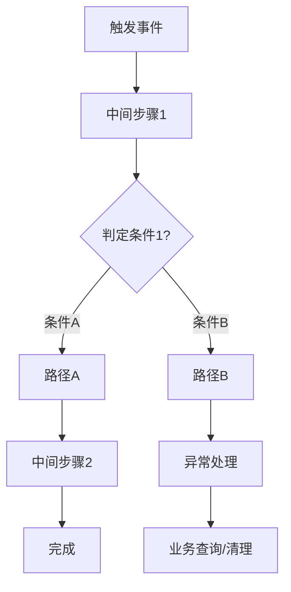
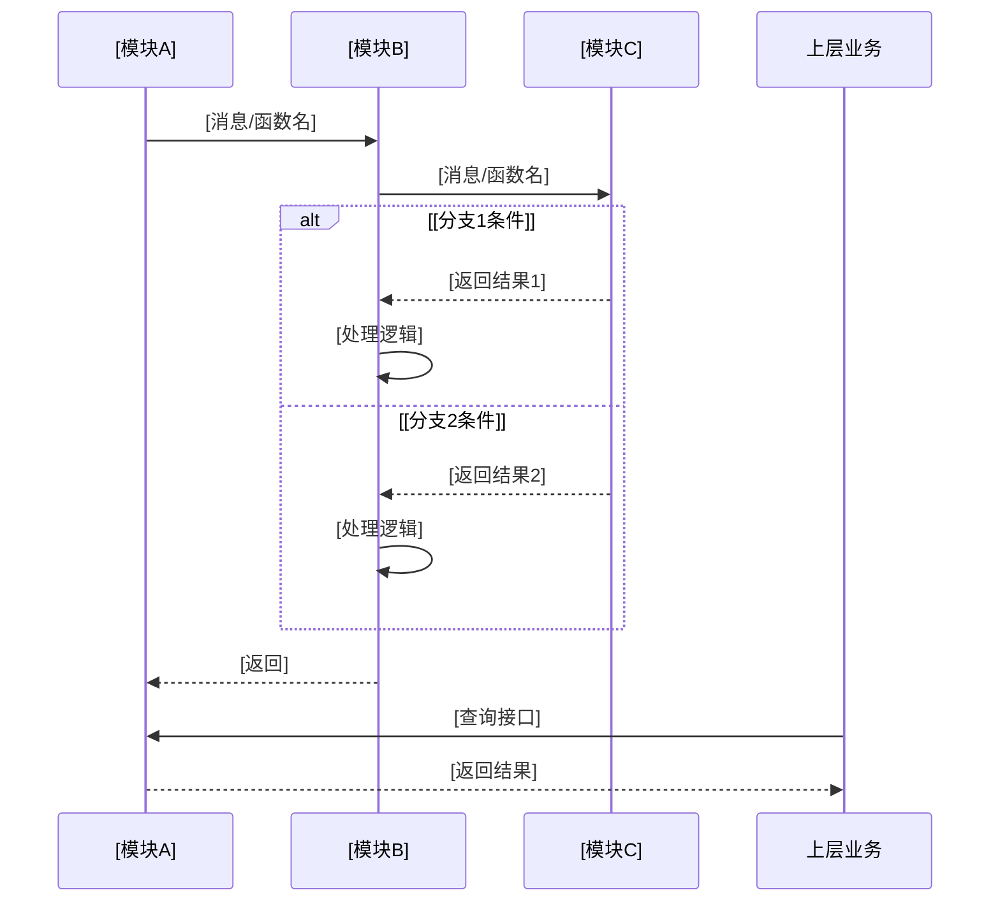
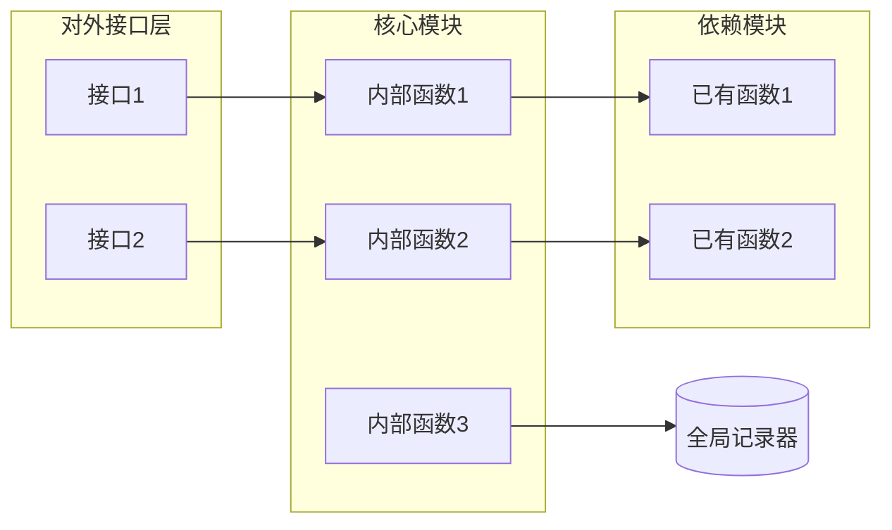

# [需求名称] — 需求实现说明书

> 版本：v1.0  
> 日期：YYYY-MM-DD  
> 模块：[所属模块名称]（用户态 `[路径]` + 内核态 `[路径]`）

---

<!-- 
模板使用说明：

1. 方括号 [] 标记为占位符，需替换为实际内容
2. 每个章节下方的灰色注释为编写指导，完成后删除
3. Mermaid 图保留结构框架，替换为实际流程
4. 表格列数和行数按实际需求调整

-->

## 目录

| 章节 | 标题 | 核心内容 |
|------|------|---------|
| §1 | 需求简介 | 1.1 背景和目的 / 1.2 需求说明（接口清单） / 1.3 支持的芯片类型与部署形态 |
| §2 | 系统交互设计 | 2.1 需求输入 / 2.2 总体处理流程 / 2.3 内部详细时序 / 2.4 关键场景分析（含 2.4.1 已有路径失败语义对齐） |
| §3 | 数据结构与架构 | 3.1 关键数据结构（新增+复用） / 3.2 数据来源分析 / 3.3 目录与文件变更 / 3.4 内部结构定义 |
| §4 | 模块交互与依赖排查 | 4.1 模块间影响分析 / 4.2 公共库依赖 / 4.3 内部实现自检清单（9 项） |
| §5 | 对外接口描述 | 接口函数原型、参数、返回码、注意事项、数据结构导出位置 |
| §6 | 资源与成本评估 | 代码量、静态内存、运行时开销、锁开销、内核态开销 |
| §7 | 测试用例设计 | 7.1 功能用例 / 7.2 并发用例 / 7.3 边界用例 |
| §8 | 变更影响分析 | 8.1 变更影响维度表（兼容性/性能/内存/线程安全/ABI/安全） / 8.2 CRIU 快照影响分析（⚠️ 人工确认） |
| §9 | 可靠性与可维护性 | 9.1 可靠性设计 / 9.2 可维护性设计 / 9.3 安全分析（安全边界+攻击面防护） |
| §10 | 可测试性分析 | 各维度可测试性评估、测试约束 |
| 附录 A | 关键代码引用 | file:line 精确定位 |
| 附录 B | 数据/场景对照表 | 多来源/多场景差异对比 |
| 附录 C | 复用接口局限性与补充方案 | 复用接口不足说明 + 补充调用链 |

---

## 1. 需求简介

### 1.1 需求背景和目的

<!-- 编写指导：

- 描述当前痛点：什么场景下会出现问题？问题的影响范围有多大？
- 量化痛点：定位时间、人工成本、效率损失等
- 点明目的：本需求提供什么能力？将效率提升到什么水平？
- 一句话概括：从"XX状态"压缩到"YY状态"

-->

[描述当前业务场景中的痛点，问题定位链条过长/效率低的原因]

当前问题定位链条：[A] → [B] → [C] → [D]，过程跨多个模块、依赖人工经验，效率低。

**本需求目的**：[在什么环节做什么事]，[提供什么能力]，将 [A] 从"小时级人工分析"压缩到"秒级接口查询"。

### 1.2 需求说明

<!-- 编写指导：

- 列出对外提供的接口/能力清单
- 每个能力一行，明确接口名、功能、输入输出
- 最后给出核心概念的精确定义（如"越界访问"的判定依据）

-->

本需求在 [模块名] 新增 [能力描述]，对外提供 [接口层] 接口：

| 功能项 | 接口 | 说明 |
|--------|------|------|
| [功能1] | `[接口名]` | [功能描述] |
| [功能2] | `[接口名]` | [功能描述] |
| [功能3] | `[接口名]` | [功能描述] |

**[核心概念]定义**：[精确描述判定条件，基于代码分析给出，不能笼统]

### 1.3 支持的芯片类型与部署形态

<!-- 编写指导：

- 列出本需求支持的芯片型号（如 A2/A3/A5/A6/910B/950 等）
- 列出支持的部署形态：物理机、容器、直通虚拟机、算力切分（vascend）等
- 标注不支持的芯片/形态及原因
- 如有互联方式差异（PCIE/UB），在此标注各芯片/形态支持的互联方式

-->

| 芯片型号 | 支持的互联方式 | 支持的部署形态 | 说明 |
|---------|--------------|--------------|------|
| [芯片1] | [PCIE/UB/...] | [物理机/容器/直通虚拟机/算力切分] | [说明] |
| [芯片2] | [PCIE/UB/...] | [物理机/容器/直通虚拟机/算力切分] | [说明] |

> **不支持的场景**：[列出不支持的芯片型号或部署形态，及原因]

---

## 2. 系统交互设计

### 2.1 需求输入

<!-- 编写指导：

- 列出实现该需求所需的全部输入项
- 每项标注：类型、来源（哪个模块/函数/结构体）、用途
- 来源要精确到代码文件或数据结构

-->

| 输入项 | 类型 | 来源 | 说明 |
|--------|------|------|------|
| [输入1] | `[类型]` | [模块/函数/结构体] | [用途] |
| [输入2] | `[类型]` | [模块/函数/结构体] | [用途] |

### 2.2 总体处理流程

<!-- 编写指导：

- 用 Mermaid flowchart 画出从触发到完成的完整链路
- 覆盖所有关键判定分支（if/else 都要画出）
- 标注每个关键步骤对应的代码函数名
- 正常路径和异常路径都要体现

-->



### 2.3 内部详细时序

<!-- 编写指导：

- 用 Mermaid sequenceDiagram 画出参与对象间的交互
- 参与对象用具体模块名/文件路径标注
- 消息标注函数名
- 用 alt/opt 块区分不同分支
- 关键步骤加 Note 标注

-->



### 2.4 关键场景分析

<!-- 编写指导：

- 逐个分析触发链路中的所有分支/场景
- 每个场景标注：判定条件、是否正常、是否需要记录/处理
- 基于 svm_pagefault_handle 的 7 分支分析模式
- 区分"正常场景"和"异常/越界场景"
- 为后续判定逻辑提供依据

-->

[核心处理函数]（`[文件:行]`）有 [N] 个退出分支，逐个分析：

| # | 场景 | 判定条件 | 是否正常 | 是否异常 | 异常类型 | 记录？ |
|---|------|----------|---------|---------|----------|--------|
| 1 | [场景1] | `[条件]` | 是/否 | 否 | — | 否 |
| 2 | [场景2] | `[条件]` | 否 | **是** | `[类型1]` | ✅ |
| 3 | [场景3] | `[条件]` | 否 | **可能** | `[类型2]` | ✅ |
| ... | ... | ... | ... | ... | ... | ... |

**异常类型说明**：

| 异常类型 | 含义 | 典因 |
|----------|------|------|
| `[类型1]` | [含义] | [典型原因] |
| `[类型2]` | [含义] | [典型原因] |

#### 2.4.1 已有路径失败语义分析（强制）

<!-- 编写指导：

- 本需求优化/替代已有路径时，必须先分析已有路径失败时的处理方式
- 追踪已有路径源码的失败分支：回滚？延迟清理？直接返回？
- 新路径的失败处理必须与已有路径语义一致
- 避免新路径设计了已有路径没有的失败处理（如"失败→回退重做"而原始路径是"失败→直接返回"）

-->

已有路径 `[已有函数名]`（`[文件:行]`）失败时的处理：

| 步骤 | 做了什么 | 源码位置 |
|------|---------|---------|
| 失败发生点 | [如：某块 map 失败] | `[文件:行]` |
| 立即处理 | [如：直接 return error / 回滚已成功的块 / 清状态] | `[文件:行]` |
| 延迟清理 | [如：等 handle free 时 unmap / 容忍 NO_PROCESS] | `[文件:行]` |

**新路径失败处理对齐**：

| 对齐项 | 已有路径 | 新路径 |
|--------|---------|--------|
| 失败时是否回滚已成功操作 | [是/否] | [必须一致] |
| 失败时返回方式 | [直接 return error] | [必须一致] |
| 失败时状态清理 | [如：清 bitmap] | [必须一致] |
| 延迟清理机制 | [如：pre_free 容忍 NO_PROCESS] | [必须一致] |

---

## 3. 数据结构与架构

### 3.1 关键数据结构

#### 3.1.1 [枚举/类型定义]（新增）

```c

/* [枚举用途说明] */
enum [枚举名] {
    [VALUE_1] = 0,
    [VALUE_2],
    [VALUE_MAX]
};

```

#### 3.1.2 [核心结构体]（新增）

```c

/* [结构体用途说明] */
struct [结构体名] {
    [类型] [字段名];    /* [字段说明] */
    [类型] [字段名];    /* [字段说明] */
    struct [子结构体] [字段名];  /* [字段说明] */
};

```

#### 3.1.3 全局记录器（新增，内部）

```c

/* [文件路径] */
struct [记录器名] {
    pthread_rwlock_t lock;
    [字段列表]
};

static struct [记录器名] g_[记录器变量];

```

#### 3.1.4 复用的现有数据结构

<!-- 编写指导：

- 列出复用的已有结构体
- 标注复用点和局限性（是否完全满足需求？需要补充什么？）

-->

| 结构 | 位置 | 复用点 | 局限性 |
|------|------|--------|--------|
| `[结构体]` | `[文件:行]` | [复用说明] | [不足之处，或"无"] |

### 3.2 数据来源分析

<!-- 编写指导：

- 如果需求涉及数据查询，列出所有数据来源
- 每个来源标注：调用链、数据特征、是否完全覆盖
- 特别标注"不覆盖的场景"（哪些数据查不到）

-->

所有通过 [对外接口] 申请的 [数据] 都经过 [核心函数] 注册到 [管理结构]：

| # | 对外接口 | 调用链 | 特征 | 覆盖？ |
|---|----------|--------|------|--------|
| 1 | `[接口A]` | →`[函数]`→`[核心函数]` | [特征] | ✅ |
| 2 | `[接口B]` | →`[函数]`→`[核心函数]` | [特征] | ✅ |
| 3 | `[接口C]` | →`[核心函数]`（直接） | [特征] | ✅ |

> **注意**：[不覆盖的场景说明，如"XX 走另一条路径，不在此结构中"]

### 3.3 目录与文件变更

<!-- 编写指导：

- 列出所有涉及的文件变更
- 标注：新增/修改
- 每个文件说明变更内容

-->

| 文件路径 | 变更类型 | 说明 |
|----------|----------|------|
| `[路径]` | **新增** | [内容] |
| `[路径]` | **修改** | [变更内容] |

### 3.4 内部结构定义

<!-- 编写指导：

- 用 Mermaid 画出模块间调用关系
- 列出所有新增内部函数

-->



#### 新增内部函数列表

| 函数名 | 文件 | 职责 |
|--------|------|------|
| `[函数名](参数)` | `[文件]` | [职责] |

---

## 4. 模块交互与依赖排查

### 4.1 模块间影响分析

<!-- 编写指导：

- 列出所有被影响的模块
- 每个模块标注：影响点、影响评估、应对措施
- 特别关注：是否影响正常路径、是否引入锁竞争

-->

| 被影响模块 | 影响点 | 影响评估 | 应对措施 |
|------------|--------|----------|----------|
| `[模块]` | [影响描述] | [正常路径零开销/异常路径增加XX] | [措施] |

### 4.2 公共库依赖

| 依赖库 | 用途 | 是否新增 | 风险 |
|--------|------|----------|------|
| `[库名]` | [用途] | 否 | 无 |

### 4.3 内部实现自检清单

<!-- 编写指导：

- 列出实现时必须检查的点
- 每项用 checkbox 格式
- 涵盖：锁配对、分支覆盖、边界条件、并发安全

-->

- [ ] [检查项1：是否在正确分支内调用，不影响正常路径]
- [ ] [检查项2：锁是否正确配对（写锁/读锁）]
- [ ] [检查项3：是否有锁嵌套死锁风险]
- [ ] [检查项4：复用已有函数时是否了解其局限性]
- [ ] [检查项5：并发场景是否处理]
- [ ] [检查项6：入参 NULL 校验]
- [ ] [检查项7：关键区分点是否正确（如两种相似 flag 的差异）]
- [ ] [检查项8：若新增/修改 H2D/D2H/K2U 消息相关逻辑（新增事件类型、修改消息结构体、修改消息发送/接收路径、修改消息处理逻辑），是否检查了 share_um_handle.c 中 um_handle pre/post handlers 的适配（grep 现有事件 → Read handler 逻辑 → 判断本次修改是否影响 → 必要时新增/修改 handlers → 检查 SVM_EVENT_HANDLE_MSG_MAX_LEN）]
- [ ] [检查项9：若变更涉及跨模块通信（esched/msg_chan/ioctl），是否穿透 SVM 边界追踪到传输层，确认每一层的约束（消息大小限制、并发限制、缓冲区大小、参数校验、硬件限制）不会被打破]

---

## 5. 对外接口描述

### 5.1 [接口1]

```c

/**

 * @brief [功能描述]
 * @param [in/out] [参数名]  [参数说明]
 * @return 0 成功；非 0 失败码
 *   - DRV_ERROR_XXX: [错误场景1]
 *   - DRV_ERROR_YYY: [错误场景2]
 * @note [线程安全性、调用时机等注意事项]

 */
int [接口名](参数列表);

```

### 5.2 [接口2]

```c

/**

 * @brief [功能描述]
 * @return 0 成功；非 0 失败码
 * @note [注意事项]

 */
int [接口名](void);

```

### 5.3 数据结构导出位置

[结构体/枚举名] 声明于 `[头文件路径]`（对外可见）。

---

## 6. 资源与成本评估

| 资源项 | 估算 | 说明 |
|--------|------|------|
| 新增代码量 | ~[N] 行 | [文件数] 个新文件 + [N] 个文件修改 |
| 新增静态内存 | ~[N] Bytes | [结构体说明] |
| 运行时开销 | [可忽略/可接受] | [触发条件及开销说明] |
| 锁开销 | [读写锁/互斥锁]，[级别] | [竞争场景说明] |
| 内核态开销 | [如有] | [说明] |

---

## 7. 测试用例设计

### 7.1 功能用例

<!-- 编写指导：

- 每个用例标注：前置条件、操作、预期结果
- 覆盖所有正常和异常分支
- 编号便于追踪

-->

| 用例 ID | 用例名 | 前置条件 | 操作 | 预期结果 |
|---------|--------|----------|------|----------|
| UT-[模块]-001 | [正常场景] | [前置] | [操作] | [预期] |
| UT-[模块]-002 | [异常场景1] | [前置] | [操作] | [预期] |
| UT-[模块]-003 | [异常场景2] | [前置] | [操作] | [预期] |
| UT-[模块]-004 | [边界场景] | [前置] | [操作] | [预期] |

### 7.2 并发用例

| 用例 ID | 用例名 | 操作 | 预期结果 |
|---------|--------|------|----------|
| UT-[模块]-CONC-001 | 并发查询 | [操作] | [预期] |
| UT-[模块]-CONC-002 | 查询与清理并发 | [操作] | [预期] |
| UT-[模块]-CONC-003 | 并发写入 | [操作] | [预期] |

### 7.3 边界用例

| 用例 ID | 用例名 | 预期结果 |
|---------|--------|----------|
| UT-[模块]-BND-001 | [NULL 入参] | 返回 `DRV_ERROR_INVALID_VALUE` |
| UT-[模块]-BND-002 | [空状态查询] | 返回 `DRV_ERROR_NOT_EXIST` |
| UT-[模块]-BND-003 | [极值边界] | [预期] |

---

## 8. 变更影响分析

<!-- 编写指导：

- 从多维度评估影响
- 每个维度给出明确结论
- 特别关注：兼容性、性能、线程安全、ABI

-->

| 维度 | 影响分析 |
|------|----------|
| **功能兼容性** | [纯新增/修改已有接口签名？对已有功能的影响] |
| **性能** | [正常路径开销？异常路径开销？是否高频场景？] |
| **内存** | [新增内存量？静态/动态？] |
| **线程安全** | [锁策略？锁嵌套风险？] |
| **ABI 兼容** | [是否改变已有接口？新增接口编号？] |
| **CRIU 热迁移** | [是否需要迁移保留？reset 回调处理？] | 
| **安全** | [是否泄露敏感信息？越权风险？] |

### 8.2 CRIU 快照影响分析

<!-- 编写指导：

- 分析本次变更是否影响 CRIU（Checkpoint/Restore In Userspace）热迁移功能
- HAL 层提供 halProcessResBackup（资源备份，drv_comm_intf.c）/ halProcessResRestore（资源恢复）接口
- 各模块通过注册 backup/restore 钩子参与快照/恢复流程
- 需逐项分析：新增/修改的状态是否需要在快照时备份、在恢复时重建
- 如新增内核态状态（如 ctx/node 字段）、用户态状态（如 handle/红黑树节点/映射关系），需评估是否需要快照适配
- 本节为重点提醒人工确认项：是否需要做快照适配需结合实际模块机制和业务场景确认

-->

#### 8.2.1 快照机制背景

HAL 层 `halProcessResBackup` / `halProcessResRestore` 在进程热迁移时遍历所有模块注册的 backup/restore 钩子，各模块按需参与资源备份与恢复。需分析本次变更新增的状态是否属于该机制覆盖范围。

#### 8.2.2 本次变更的快照影响评估

| 变更项 | 是否新增/修改状态 | 状态生命周期 | 是否需要快照适配 | 说明 |
|--------|----------------|------------|----------------|------|
| [变更项1，如：新增内核态字段] | [是/否] | [如：get/put 配对释放/进程级持久] | [是/否] | [说明原因] |
| [变更项2，如：新增导出接口] | [是/否] | [如：无状态] | [是/否] | [说明原因] |

#### 8.2.3 人工确认事项

> ⚠️ **以下事项需人工确认**：

> 1. 本次变更新增的状态（如果有）是否需要在进程热迁移时备份和恢复？
> 2. 如果需要快照适配，是否需要新增或修改 backup/restore 钩子注册？
> 3. 是否影响已有模块的快照恢复逻辑？

---

## 9. 可靠性与可维护性

### 9.1 可靠性设计

<!-- 编写指导：

- 列出可能的故障场景和应对措施
- 特别关注：锁泄漏、调用失败、并发竞争、高频触发

-->

| 风险 | 应对 |
|------|------|
| [锁未释放] | [配对策略] |
| [依赖函数失败] | [降级策略，不影响主信息] |
| [并发竞争] | [锁策略] |
| [未初始化] | [初始化保障] |
| [高频触发风暴] | [限流/只保留最新] |

### 9.2 可维护性设计

- **模块化**：[新逻辑独立为文件，与已有逻辑解耦]
- **可观测**：[日志级别、限流策略、关键信息打印]
- **可扩展**：[结构体预留扩展字段]
- **类型可区分**：[枚举区分不同场景，便于针对性定位]

### 9.3 安全分析

<!-- 编写指导：

- 基于 §2 系统交互设计，分析本次变更是否引入新的安全边界
- 逐项检查：是否新增跨特权态调用（内核态↔用户态）、跨设备通信、跨进程数据访问
- 分析是否存在攻击面：如恶意传入非法 VA/参数导致越权访问、信息泄露、DoS 等
- 给出防护措施：入参校验、权限校验、地址合法性校验、资源限制等
- 如果本次变更是纯内核态内部扩展且不新增跨边界调用，可简化但仍需明确说明"无新增安全边界"

-->

#### 9.3.1 安全边界分析

| 安全边界 | 变更前状态 | 变更后是否新增 | 说明 |
|---------|----------|--------------|------|
| 内核态↔用户态（K2U/ioctl） | [已有/无] | [是/否] | [说明] |
| Host↔Device（KMC H2D/D2H） | [已有/无] | [是/否] | [说明] |
| 跨进程数据访问 | [已有/无] | [是/否] | [说明] |
| 内核态导出符号（KA_EXPORT_SYMBOL） | [已有/无] | [是/否] | [说明] |

#### 9.3.2 攻击面分析与防护

| 攻击场景 | 风险等级 | 攻击方式 | 防护措施 |
|---------|---------|---------|---------|
| [如：恶意传入非法 VA] | [高/中/低] | [攻击者传入非 SVM 范围的 VA，导致越权查询] | [入参校验：VA 范围校验 / udevid 权限校验] |
| [如：DoS 频繁调用] | [高/中/低] | [攻击者频繁调用接口消耗 KMC 带宽] | [限流 / 资源限制] |
| [如：信息泄露] | [高/中/低] | [通过返回值推断其他进程内存布局] | [仅返回调用方有权访问的 VA 信息] |

> 如果本次变更为纯内核态内部扩展，不新增跨特权态/跨设备/跨进程安全边界，在此明确说明：
> "本次变更无新增安全边界，[说明原因]，无需额外安全防护。"

---

## 10. 可测试性分析

| 测试维度 | 可测试性评估 | 方案 |
|----------|--------------|------|
| **接口直接测试** | 高 | [方案] |
| **异常触发测试** | 高/中 | [mock 方案] |
| **状态查询测试** | 高/中 | [mock 方案] |
| **并发测试** | 高 | [方案] |
| **端到端测试** | 高/中 | [方案，硬件依赖说明] |
| **日志验证** | 高 | [方案] |
| **覆盖率** | 高 | [分支数评估] |

### 测试约束

- [UT 环境需要提供的 stub 或链接的真实实现]
- [哪些测试依赖硬件环境，作为 ST 用例]

---

## 附录 A：关键代码引用

<!-- 编写指导：

- 列出设计依据的关键代码位置
- 精确到 文件:行号
- 用于实现阶段快速定位

-->

| 引用点 | 文件:行 | 说明 |
|--------|---------|------|
| [关键结构体] | `[文件:行]` | [说明] |
| [关键函数] | `[文件:行]` | [说明] |
| [判定逻辑] | `[文件:行]` | [说明] |

## 附录 B：[数据/场景对照表]

<!-- 编写指导：

- 如果有多种数据来源或场景，用对照表总结
- 帮助实现者快速理解不同场景的差异

-->

| 场景/来源 | 查询结果 | 特征1 | 特征2 | 缺页后分支 | 处理类型 |
|-----------|---------|------|------|-----------|----------|
| [场景1] | [结果] | [特征] | [特征] | [分支] | [类型] |
| [场景2] | [结果] | [特征] | [特征] | [分支] | [类型] |

## 附录 C：[复用接口] 局限性与补充方案

<!-- 编写指导：

- 如果复用了已有接口但有不足，在此说明
- 给出补充方案
- 参考已有实现

-->

**局限性**：[复用接口] 返回的是 [A]，不包含 [B] 信息。

**补充方案**：[通过什么方式补充缺失的信息]

```text

[补充方案的调用链伪代码]

```

参考已有实现：[已有函数]（`[文件:行]`）已通过 [方法] 实现 [类似功能]。
