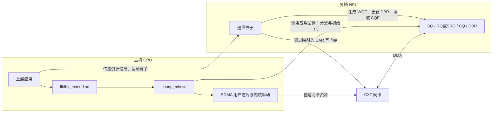

# CX7 provider使用指导

## 目录

- [1. 简介](#1-简介)
- [2. 应用场景](#2-应用场景)
- [3. 安装](#3-安装)
  - [3.1 编译安全函数库](#31-编译安全函数库)
  - [3.2 CX7 Provider 编译](#32-cx7-provider-编译)
- [4. 使用](#4-使用)

## 1. 简介

CX7 Provider 是 ConnectX-7 网卡的 NDA（NPU Direct Async）用户态适配组件，通过 ibv_extend 扩展框架向上层应用提供设备查询、QP/CQ/SRQ 创建销毁及 QP UDP 源端口修改能力。

| 组件 | 作用 |
|---|---|
| `libibv_extend.so` | 扩展接口框架，负责 Provider 加载、设备匹配、扩展上下文管理和接口分派 |
| `libadp_mlx.so` | 统一的 mlx5 V2 Provider，保留 NDA 资源接口，并提供 UDP 源端口修改接口 |
| `libibverbs.so` / `libmlx5.so` | 环境中的 RDMA 用户态库，配合内核驱动完成网卡资源管理 |

应用通过 `ibv_extend_ops` 提供内存分配、释放、拷贝和门铃映射回调。回调返回 NPU 内存时，队列和 DBR（门铃记录）可位于 NPU；资源管理对象保留在 Host。接口定义见 [ibv_extend.h](../../ibv_extend/ibv_extend.h)，Provider 入口见 [adp_mlx.c](../adp_mlx.c)。

## 2. 应用场景

NPU Direct Async 适用于由昇腾 NPU 通信算子直接操作 CX7 队列和门铃的通信场景。CPU 上的应用负责创建资源、注册业务内存、建立连接，并将队列布局与门铃信息传递给 NPU 算子。NPU 算子生成 WQE、更新 DBR、通知网卡并读取 CQE，减少逐条通信请求由 Host CPU 投递和处理的开销。



该场景需要应用提供 NPU 内存回调、适配 CX7 格式的通信算子，以及平台对 NPU 内存 DMA 和门铃映射的支持。Provider 负责资源管理和信息导出；接口资源测试通过不等于 NPU 数据面通信已经验证。

## 3. 安装

编译环境需安装配套的 `2410mlnx54` 系列 `rdma-core-devel` 和 `libibverbs`，提供 verbs/mlx5 头文件及 RDMA 用户态库。请使用与运行环境配套的 NVIDIA RDMA 软件包。

### 3.1 编译安全函数库

从 [libboundscheck 发布页](https://gitcode.com/cann-src-third-party/libboundscheck/releases) 获取源码包。以下以开发指南中的 [libboundscheck-v1.1.16.tar.gz](https://gitcode.com/cann-src-third-party/libboundscheck/releases/download/v1.1.16/libboundscheck-v1.1.16.tar.gz) 为例，将压缩包放到编译机 `/tmp/` 后执行：

```bash
mkdir -p "$HOME/nda-deps"
tar -xzf /tmp/libboundscheck-v1.1.16.tar.gz -C "$HOME/nda-deps"
cd "$HOME/nda-deps/libboundscheck-v1.1.16"
make -j"$(nproc)"
cp lib/libboundscheck.so lib/libc_sec.so
```

编译后，`include/` 提供 `securec.h`、`securectype.h`，`lib/` 提供共享库。

运行时将对应的库目录加入搜索路径：

```bash
export LD_LIBRARY_PATH="$HOME/nda-deps/libboundscheck-v1.1.16/lib${LD_LIBRARY_PATH:+:$LD_LIBRARY_PATH}"
```

### 3.2 CX7 Provider 编译

以下以仓库 `/home/test/driver_8587` 和 3.1 节编译的安全函数库为例，请按实际目录调整路径。

**1. 编译 CX7 Provider 和扩展接口框架。**

```bash
cd /home/test/driver_8587/src/custom/nda/adp_mlx

export NDA_SECUREC_INCLUDE_DIR="$HOME/nda-deps/libboundscheck-v1.1.16/include"
export NDA_SECUREC_LIBRARY="$HOME/nda-deps/libboundscheck-v1.1.16/lib/libc_sec.so"

bash build.sh
```

确认构建成功并输出 `Staged NDA in .../output`。查看编译产物：

```bash
ls -l output/include/ibv_extend.h output/lib/libibv_extend.so* output/lib/libadp_mlx.so*
```

**2. 安装共享库和头文件。**

在 `adp_mlx` 目录执行：

```bash
install -d /usr/local/lib64 /usr/local/include
cp -a output/lib/libadp_mlx.so* /usr/local/lib64/
cp -a output/lib/libibv_extend.so* /usr/local/lib64/
install -m 644 output/include/ibv_extend.h /usr/local/include/
ldconfig
```

使用 `output/lib` 或上述安装目录，按第 4 节配置动态库路径和 Provider 加载方式。

## 4. 使用

### 4.1 配置动态库路径

在应用启动环境中设置以下变量。`NDA_LIBRARY_DIR` 是本示例的路径变量：使用系统安装目录时设为 `/usr/local/lib64`；直接使用产物时设为实际 `adp_mlx/output/lib` 绝对路径。

```bash
export NDA_LIBRARY_DIR=/usr/local/lib64
export NDA_SECUREC_LIBRARY="$HOME/nda-deps/libboundscheck-v1.1.16/lib/libc_sec.so"
export LD_LIBRARY_PATH="$NDA_LIBRARY_DIR:$(dirname -- "$NDA_SECUREC_LIBRARY")${LD_LIBRARY_PATH:+:$LD_LIBRARY_PATH}"

ldd "$NDA_LIBRARY_DIR/libadp_mlx.so" "$NDA_LIBRARY_DIR/libibv_extend.so"
```

确认没有 `not found`，并核对框架、RDMA 库和安全函数库的实际加载路径。环境变量须在运行应用的终端或启动脚本中生效。

### 4.2 配置 Provider 加载

扩展框架支持环境变量和配置文件两种方式，选择一种即可。

**方式一：环境变量。** 指定 Provider 的绝对路径，不需要配置文件：

```bash
export IBV_EXTEND_DRIVERS="$NDA_LIBRARY_DIR/libadp_mlx.so"
```

多个 Provider 可使用 `:` 或 `;` 分隔。

**方式二：配置文件。** 库已安装且可被动态加载时，以 root 创建配置：

```bash
install -d /etc/libibverbs_extend.d
printf 'driver adp_mlx\n' > /etc/libibverbs_extend.d/adp_mlx.conf
unset IBV_EXTEND_DRIVERS
```

配置中的 `adp_mlx` 对应 `libadp_mlx.so`。配置文件负责发现 Provider，不能代替 4.1 节的动态库依赖配置。
