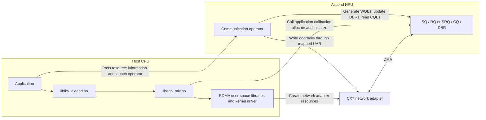

# CX7 Provider User Guide

## Table of Contents

- [1. Introduction](#1-introduction)
- [2. Use Cases](#2-use-cases)
- [3. Installation](#3-installation)
  - [3.1 Build the Secure Function Library](#31-build-the-secure-function-library)
  - [3.2 Build the CX7 Provider](#32-build-the-cx7-provider)
- [4. Usage](#4-usage)

## 1. Introduction

CX7 Provider is a user-space NDA (NPU Direct Async) adaptation component for ConnectX-7 network adapters. Through the ibv_extend extension framework, it provides applications with device queries, QP/CQ/SRQ creation and destruction, and QP UDP source port modification.

| Component | Purpose |
|---|---|
| `libibv_extend.so` | Extension interface framework responsible for Provider loading, device matching, extension context management, and interface dispatch |
| `libadp_mlx.so` | Unified mlx5 V2 Provider that retains the NDA resource interfaces and provides a UDP source port modification interface |
| `libibverbs.so` / `libmlx5.so` | RDMA user-space libraries in the environment that work with the kernel driver to manage network adapter resources |

Applications provide memory allocation, deallocation, copying, and doorbell mapping callbacks through `ibv_extend_ops`. When the callbacks return NPU memory, queues and DBRs (doorbell records) can reside on the NPU; resource management objects remain on the host. See [ibv_extend.h](../../ibv_extend/ibv_extend.h) for interface definitions and [adp_mlx.c](../adp_mlx.c) for the Provider entry point.

## 2. Use Cases

NPU Direct Async is intended for communication scenarios in which Ascend NPU communication operators directly operate CX7 queues and doorbells. The application on the CPU creates resources, registers application memory, establishes connections, and passes queue layouts and doorbell information to the NPU operators. The NPU operators generate WQEs, update DBRs, notify the network adapter, and read CQEs, reducing the overhead of having the host CPU post and process each communication request.



This scenario requires application-provided NPU memory callbacks, communication operators adapted to the CX7 format, and platform support for DMA to NPU memory and doorbell mapping. The Provider manages resources and exports information; passing interface resource tests does not mean that NPU data-plane communication has been verified.

## 3. Installation

Install matching `2410mlnx54` series `rdma-core-devel` and `libibverbs` packages in the build environment to provide verbs/mlx5 headers and RDMA user-space libraries. Use the NVIDIA RDMA packages that match the runtime environment.

### 3.1 Build the Secure Function Library

Obtain the source archive from the [libboundscheck releases page](https://gitcode.com/cann-src-third-party/libboundscheck/releases). The following example uses [libboundscheck-v1.1.16.tar.gz](https://gitcode.com/cann-src-third-party/libboundscheck/releases/download/v1.1.16/libboundscheck-v1.1.16.tar.gz) from the development guide. Place the archive in `/tmp/` on the build machine, then run:

```bash
mkdir -p "$HOME/nda-deps"
tar -xzf /tmp/libboundscheck-v1.1.16.tar.gz -C "$HOME/nda-deps"
cd "$HOME/nda-deps/libboundscheck-v1.1.16"
make -j"$(nproc)"
cp lib/libboundscheck.so lib/libc_sec.so
```

After the build, `include/` provides `securec.h` and `securectype.h`, and `lib/` provides the shared library.

Add the corresponding library directory to the runtime search path:

```bash
export LD_LIBRARY_PATH="$HOME/nda-deps/libboundscheck-v1.1.16/lib${LD_LIBRARY_PATH:+:$LD_LIBRARY_PATH}"
```

### 3.2 Build the CX7 Provider

The following example uses the repository at `/home/test/driver_8587` and the secure function library built in Section 3.1. Adjust the paths to match your directories.

**1. Build the CX7 Provider and the extension interface framework.**

```bash
cd /home/test/driver_8587/src/custom/nda/adp_mlx

export NDA_SECUREC_INCLUDE_DIR="$HOME/nda-deps/libboundscheck-v1.1.16/include"
export NDA_SECUREC_LIBRARY="$HOME/nda-deps/libboundscheck-v1.1.16/lib/libc_sec.so"

bash build.sh
```

Confirm that the build succeeds and that `Staged NDA in .../output` is printed. Inspect the build artifacts:

```bash
ls -l output/include/ibv_extend.h output/lib/libibv_extend.so* output/lib/libadp_mlx.so*
```

**2. Install the shared libraries and header.**

Run the following in the `adp_mlx` directory:

```bash
install -d /usr/local/lib64 /usr/local/include
cp -a output/lib/libadp_mlx.so* /usr/local/lib64/
cp -a output/lib/libibv_extend.so* /usr/local/lib64/
install -m 644 output/include/ibv_extend.h /usr/local/include/
ldconfig
```

Use `output/lib` or the installation directory above to configure the dynamic library path and Provider loading as described in Section 4.

## 4. Usage

### 4.1 Configure the Dynamic Library Path

Set the following variables in the application's startup environment. `NDA_LIBRARY_DIR` is a path variable used in this example: set it to `/usr/local/lib64` when using the system installation directory, or to the actual absolute path of `adp_mlx/output/lib` when using the build artifacts directly.

```bash
export NDA_LIBRARY_DIR=/usr/local/lib64
export NDA_SECUREC_LIBRARY="$HOME/nda-deps/libboundscheck-v1.1.16/lib/libc_sec.so"
export LD_LIBRARY_PATH="$NDA_LIBRARY_DIR:$(dirname -- "$NDA_SECUREC_LIBRARY")${LD_LIBRARY_PATH:+:$LD_LIBRARY_PATH}"

ldd "$NDA_LIBRARY_DIR/libadp_mlx.so" "$NDA_LIBRARY_DIR/libibv_extend.so"
```

Confirm that there are no `not found` entries, and check the actual load paths for the framework, RDMA libraries, and secure function library. The environment variables must take effect in the terminal or startup script used to run the application.

### 4.2 Configure Provider Loading

The extension framework supports both environment variables and configuration files; choose either method.

**Method 1: Environment variable.** Specify the Provider's absolute path; no configuration file is required:

```bash
export IBV_EXTEND_DRIVERS="$NDA_LIBRARY_DIR/libadp_mlx.so"
```

Separate multiple Providers with `:` or `;`.

**Method 2: Configuration file.** Once the libraries are installed and can be loaded dynamically, create the configuration as root:

```bash
install -d /etc/libibverbs_extend.d
printf 'driver adp_mlx\n' > /etc/libibverbs_extend.d/adp_mlx.conf
unset IBV_EXTEND_DRIVERS
```

The `adp_mlx` entry in the configuration corresponds to `libadp_mlx.so`. The configuration file enables Provider discovery; it does not replace the dynamic library dependency configuration in Section 4.1.
